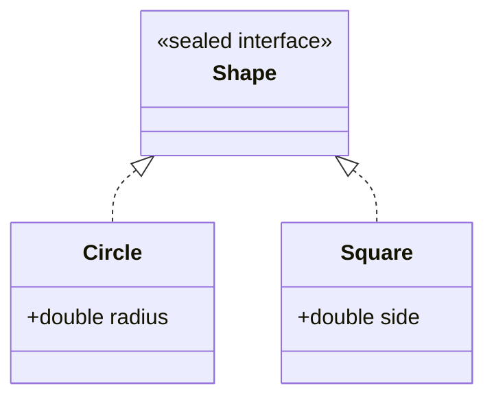

# Enums & Records — Modeling Data Precisely

Three modern features let you model data so precisely that whole categories of bugs become impossible to write:

- An **enum** is a fixed set of named constants. You list every value of the type up front, so an invalid one simply can't exist.
- A **record** (Java 16) is a data carrier. You declare its *components*, and Java generates the constructor, the accessors, and a correct [`equals`/`hashCode`](/synapse/programming-languages/java/core-libraries/equals-and-hashcode)/`toString` for you <abbr title="JEP 395: Records">[1]</abbr>.
- A **sealed** type (Java 17) names exactly which classes may implement it, so its set of subtypes is closed and known <abbr title="JEP 409: Sealed Classes">[2]</abbr>.

Together, they replace piles of hand-written boilerplate — along with the bugs that like to hide in it.

<div style="border-left:4px solid #195045;background:rgba(25,80,69,0.08);padding:0.6rem 1rem;border-radius:0 0.5rem 0.5rem 0;margin:1.25rem 0">

💡 **The core idea.**

- An **enum** is a fixed set of named constants — an invalid value can't exist.
- A **record** generates its constructor, accessors and `equals`/`hashCode`/`toString` from its components.
- A **sealed** type names exactly which subtypes may exist — a closed, known set.
- Together, they replace hand-written boilerplate and the bugs hiding in it.

</div>

Every output below was produced by compiling and running the code on Java 21.

**You'll be able to:** declare an enum, and predict what `ordinal()`, `values()`, `valueOf` and an exhaustive `switch` over it do; give enum constants fields, a constructor and methods; declare a record, predict its `toString`, accessors and `equals`, and validate it in a compact constructor; explain why a record holding a `List` isn't fully immutable, and fix it; predict which classes may implement a sealed interface.

<div style="border-left:4px solid #15448e;background:rgba(21,68,142,0.08);padding:0.6rem 1rem;border-radius:0 0.5rem 0.5rem 0;margin:1.25rem 0">

📘 **How to read the Intuition boxes.** Each one is built in three moves:

1. **The mechanism** — what the compiler and the JVM *do*.
2. **A concrete bite** — a specific, runnable failure (often a real compiler error), shown so the trap is visible.
3. **The earned rule** — the decision heuristic, now justified rather than asserted, plus its cost.

</div>

---

## Table of contents

1. [Enums: a fixed set of constants](#1-enums-a-fixed-set-of-constants)
2. [Rich enums: fields and methods](#2-rich-enums-fields-and-methods)
3. [Records: immutable data carriers](#3-records-immutable-data-carriers)
4. [Sealed types: a first look](#4-sealed-types-a-first-look)
5. [Mental-model summary](#5-mental-model-summary)
6. [Gotcha checklist](#6-gotcha-checklist)
7. [Check yourself](#-check-yourself)
8. [Sources](#-sources)

---

## 1. Enums: a fixed set of constants

An `enum` declares a type whose only values are the named constants you list. Each constant is the one and only object of its kind. That makes the type safe (nobody can pass in a stray string), and it makes it a natural fit for a [`switch`](/synapse/programming-languages/java/control-flow/conditionals).

```java run
enum Day { MON, TUE, WED, THU, FRI, SAT, SUN }

public class Main {
    public static void main(String[] args) {
        Day d = Day.WED;
        System.out.println(d);
        System.out.println(d.ordinal());
        String kind = switch (d) {
            case SAT, SUN -> "weekend";
            default -> "weekday";
        };
        System.out.println(kind);
        System.out.println(Day.values().length);
    }
}
```

**Output:**
```
WED
2
weekday
7
```

**Analysis.**

- `Day.WED` prints its own name.
- `ordinal()` is its position, counting from zero, so it's `2` <abbr title="Java SE 21 API, java.lang.Enum">[3]</abbr>.
- The `switch` classified it as a `weekday`.
- `Day.values()` returns all seven constants.

A `Day` variable can hold *only* one of these seven, or `null`. There's no eighth day, and no way to assign a misspelled one, because the compiler checks every `Day` value against the declared set.

**Intuition.**
*Mechanism.* Each constant becomes an implicitly declared `public static final` field that holds an instance of the enum type <abbr title="The Java Language Specification, Java SE 21, §8.9.3">[4]</abbr>. Those instances are created exactly once, when the enum class is initialized. A variable of the enum type can reference only those instances, so the set of valid values is closed at compile time.

Since each constant is the only instance of its kind, `==` is safe for enums. In fact, the JLS explicitly permits it "in place of the `equals` method" <abbr title="The Java Language Specification, Java SE 21, §8.9.1">[5]</abbr>.

*Concrete bite.* Because the set is closed, the compiler can check a `switch` *expression* over an enum for exhaustiveness. Cover some constants but not all, with no `default`, and it won't compile:

```java run
enum Day { MON, TUE, WED, THU, FRI, SAT, SUN }

public class Main {
    public static void main(String[] args) {
        Day d = Day.WED;
        String s = switch (d) {
            case MON -> "monday";
            case TUE -> "tuesday";
        };
        System.out.println(s);
    }
}
```

**Compiler error:**
```
Main.java:6: error: the switch expression does not cover all possible input values
        String s = switch (d) {
                   ^
```

This `switch` handles only two of the seven days, yet it must produce a value, so the compiler demands the rest (or a `default`). With an enum, "I forgot a case" becomes a build error instead of a bug.

To turn text from outside the program into an enum constant, use `valueOf`. It matches the name exactly, including case:

```java run
enum Day { MON, TUE, WED, THU, FRI, SAT, SUN }

public class Main {
    public static void main(String[] args) {
        System.out.println(Day.valueOf("WED"));
        System.out.println(Day.valueOf("WED") == Day.WED);
        System.out.println(Day.valueOf("wed"));
    }
}
```

**Output** *(prints two lines, then a thrown exception):*
```
WED
true
Exception in thread "main" java.lang.IllegalArgumentException: No enum constant Day.wed
```

`valueOf("WED")` returned the existing constant, so `==` is `true`. But `"wed"` doesn't exactly match any name, so it throws. Normalize typed input first — for example, with `toUpperCase()` — and be ready to handle the exception anyway.

<div style="border-left:4px solid #195045;background:rgba(25,80,69,0.08);padding:0.6rem 1rem;border-radius:0 0.5rem 0.5rem 0;margin:1.25rem 0">

💡 **Earned rule.** Use an enum for any value that comes from a fixed, known set — states, directions, days, modes — instead of `int` codes or `String`s. The cost is declaring the type. The payoff is type safety (no invalid values), readable names, and a `switch` that flags a forgotten case at compile time.

</div>

---

## 2. Rich enums: fields and methods

Enum constants are real objects, which means they can carry both **data** and **behavior**. Give the enum a constructor and some fields, pass each constant its values in parentheses, and then add methods that use those values.

```java run
enum Planet {
    EARTH(9.81), MARS(3.71), MOON(1.62);

    private final double gravity;
    Planet(double gravity) { this.gravity = gravity; }
    double weightOf(double mass) { return mass * gravity; }
}

public class Main {
    public static void main(String[] args) {
        for (Planet p : Planet.values()) {
            System.out.printf("%s: %.1f%n", p, p.weightOf(10));
        }
    }
}
```

**Output:**
```
EARTH: 98.1
MARS: 37.1
MOON: 16.2
```

**Analysis.** Each constant passed a `gravity` value to the enum's constructor (`EARTH(9.81)`). The constructor stored it in a field, and `weightOf` used it. So `Planet` isn't just three names: it's three objects, each bundling a value with a method, and `values()` lets you loop over them.

The field is `final` by choice, because nothing should change a planet's gravity. The JLS doesn't require it, though. An enum with a non-`final` field compiles fine, and then any code can change it. Keep enum fields `final`, since every part of the program shares the one instance.

**Intuition.**
*Mechanism.* `EARTH(9.81)` calls the enum's constructor when the constant is created — once, as the enum class is initialized <abbr title="The Java Language Specification, Java SE 21, §8.9.3">[4]</abbr>. The fields and methods turn each constant into a small, self-describing object. In other words, an enum is a class whose instances are fixed and named.

The constructor is private even when you write no modifier <abbr title="The Java Language Specification, Java SE 21, §8.9.2">[6]</abbr>, so no other code can create a new constant:

```java run
enum Planet {
    EARTH(9.81);

    private final double gravity;
    Planet(double gravity) { this.gravity = gravity; }
}

public class Main {
    public static void main(String[] args) {
        Planet p = new Planet(3.71);
    }
}
```

**Compiler error:**
```
Main.java:10: error: enum classes may not be instantiated
        Planet p = new Planet(3.71);
                   ^
```

*Concrete bite.* This pattern replaces the fragile "parallel arrays" or `switch`-on-a-code style. Without it, you'd write something like a `double gravityFor(int planetCode)` with a `switch` that you have to keep in sync by hand. With it, the data lives *on* the constant. Adding a planet means adding one line, and nothing can fall out of step.

<div style="border-left:4px solid #195045;background:rgba(25,80,69,0.08);padding:0.6rem 1rem;border-radius:0 0.5rem 0.5rem 0;margin:1.25rem 0">

💡 **Earned rule.** Put per-constant data and behavior *in* the enum (fields, a constructor, methods), rather than in external `switch`es keyed on the constant. The cost is a richer enum declaration. The payoff is that each constant is self-contained: to add or change one, there's a single place to edit.

</div>

---

## 3. Records: immutable data carriers

A **record** is a class whose whole job is to hold data. You declare its **components**, and Java generates the rest <abbr title="The Java Language Specification, Java SE 21, §8.10.3">[7]</abbr>:

- a `private final` field per component;
- a **canonical constructor** that takes every component, in order;
- an accessor method per component, named after it;
- `equals`, `hashCode` and `toString` over all the components.

```java run
record Point(int x, int y) {}

public class Main {
    public static void main(String[] args) {
        Point a = new Point(1, 2);
        Point b = new Point(1, 2);
        System.out.println(a);
        System.out.println(a.x() + "," + a.y());
        System.out.println(a.equals(b));
        System.out.println(a.hashCode() == b.hashCode());
    }
}
```

**Output:**
```
Point[x=1, y=2]
1,2
true
true
```

**Analysis.** That single line, `record Point(int x, int y) {}`, gave us all of this:

- a constructor: `new Point(1, 2)`;
- accessors: `a.x()` and `a.y()`, with parentheses;
- a readable `toString`: `Point[x=1, y=2]`;
- a **correct** `equals`/`hashCode` pair: `a.equals(b)` is `true`, and their hash codes match.

Remember from [equals & hashCode](/synapse/programming-languages/java/core-libraries/equals-and-hashcode) how much hand-written code that contract took? A record generates it from the components, the same way every time. (One caveat: the `toString` format is not a contract. The API says it "is subject to change" <abbr title="Java SE 21 API, java.lang.Record">[8]</abbr>, so never parse it.)

**Intuition.**
*Mechanism.* A record class is implicitly `final`, and its superclass is always `java.lang.Record`, so it can't `extend` another class <abbr title="The Java Language Specification, Java SE 21, §8.10">[9]</abbr>. The compiler derives the members from the component list. You can still add your own methods, and you can check the values in a **compact constructor** — a constructor with no parameter list that runs before the fields are assigned <abbr title="The Java Language Specification, Java SE 21, §8.10.4.2">[10]</abbr>:

```java run
record Range(int low, int high) {
    Range {                                   // compact constructor: no parameter list
        if (low > high) {
            throw new IllegalArgumentException("low " + low + " > high " + high);
        }
    }

    int length() {
        return high - low;
    }
}

public class Main {
    public static void main(String[] args) {
        Range r = new Range(2, 5);
        System.out.println(r + " has length " + r.length());
        new Range(5, 2);
    }
}
```

**Output** *(prints one line, then a thrown exception):*
```
Range[low=2, high=5] has length 3
Exception in thread "main" java.lang.IllegalArgumentException: low 5 > high 2
```

The compact constructor rejected `(5, 2)`, so an invalid `Range` can never exist. Meanwhile, `length()` is just an ordinary method added to the record.

*Concrete bite.* The immutability is real. Record components are `final` and come with no setters, so you can't change one after construction:

```java run
record Point(int x, int y) {}

public class Main {
    public static void main(String[] args) {
        Point p = new Point(1, 2);
        p.x = 5;
        System.out.println(p);
    }
}
```

**Compiler error:**
```
Main.java:6: error: x has private access in Point
        p.x = 5;
         ^
1 error
```

`p.x = 5` is rejected, because the component field is `private` and `final`. The only way to read it is through the accessor `p.x()`. To "change" a point, you build a new one.

*Non-example: a mutable component.* `final` protects the field, not the object the field refers to — just like the `final` array in [Encapsulation & Access Modifiers](/synapse/programming-languages/java/classes-and-objects/encapsulation-and-access-modifiers). So a record that holds a `List` shares that list with whoever else has it:

```java run
import java.util.ArrayList;
import java.util.List;

record Team(String name, List<String> members) {}

public class Main {
    public static void main(String[] args) {
        List<String> people = new ArrayList<>(List.of("Ada"));
        Team t = new Team("core", people);
        people.add("Linus");
        t.members().add("Grace");
        System.out.println(t);
    }
}
```

**Output:**
```
Team[name=core, members=[Ada, Linus, Grace]]
```

The "immutable" `Team` changed twice: once through the caller's `people` list, and once through its own accessor. The fix is a defensive copy in the compact constructor, where `List.copyOf` makes an unmodifiable copy:

```java run
import java.util.ArrayList;
import java.util.List;

record Team(String name, List<String> members) {
    Team {
        members = List.copyOf(members);       // defensive, unmodifiable copy
    }
}

public class Main {
    public static void main(String[] args) {
        List<String> people = new ArrayList<>(List.of("Ada"));
        Team t = new Team("core", people);
        people.add("Linus");
        System.out.println(t);
        t.members().add("Grace");
    }
}
```

**Output** *(prints one line, then a thrown exception):*
```
Team[name=core, members=[Ada]]
Exception in thread "main" java.lang.UnsupportedOperationException
```

Now the caller's later `add` no longer reaches the record, and the list from the accessor refuses changes.

<div style="border-left:4px solid #195045;background:rgba(25,80,69,0.08);padding:0.6rem 1rem;border-radius:0 0.5rem 0.5rem 0;margin:1.25rem 0">

💡 **Earned rule.** Use a record for any group of values that shouldn't change: coordinates, a name-and-email pair, a `Map` key. Validate in a compact constructor, and copy any mutable components there too.

The cost is that a record's fields can't change, and a record can't extend a class. The payoff is a correct, concise value type, where a hand-written class would take dozens of lines of boilerplate.

</div>

---

## 4. Sealed types: a first look

A **sealed** interface or class uses a `permits` clause to name exactly which types may implement or extend it. Its set of subtypes is then *closed*: the compiler knows every possible implementation. That's the foundation for the exhaustive pattern matching you'll meet in [Sealed Classes & Pattern Matching](/synapse/programming-languages/java/robust-oop/sealed-classes-and-pattern-matching).

```java run
sealed interface Shape permits Circle, Square {}
record Circle(double radius) implements Shape {}
record Square(double side) implements Shape {}

public class Main {
    public static void main(String[] args) {
        Shape s = new Circle(2.0);
        System.out.println(s);
    }
}
```

**Output:**
```
Circle[radius=2.0]
```



**Analysis.** `Shape` permits exactly `Circle` and `Square`, which are both records here — records and sealed types pair naturally. The diagram shows the closed family: a `Shape` is either a `Circle` or a `Square`, and nothing else can claim to be one. A plain interface can't make that promise, because any class anywhere may implement it.

**Intuition.**
*Mechanism.* `sealed … permits A, B` writes the allowed subtypes into the type itself, and the compiler lets only those types extend or implement it. Each of them, in turn, must say whether the family stays closed below it <abbr title="The Java Language Specification, Java SE 21, §8.1.1.2">[11]</abbr>:

- `final`: no subclasses (a record is implicitly `final`);
- `sealed`: its own `permits` list;
- `non-sealed`: open again to any subclass.

A plain class that forgets to choose gets rejected: `class Square implements Shape {}` gives `error: sealed, non-sealed or final modifiers expected`.

*Concrete bite.* A type that isn't in the `permits` clause can't join the family:

```java run
sealed interface Shape permits Circle {}
record Circle(double radius) implements Shape {}
record Triangle(double base) implements Shape {}

public class Main {
    public static void main(String[] args) { }
}
```

**Compiler error:**
```
Main.java:3: error: class is not allowed to extend sealed class: Shape (as it is not listed in its 'permits' clause)
```

`Triangle` tried to implement `Shape` without being permitted, so the compiler rejected it. The family stays exactly `{Circle}` — the seal holds.

<div style="border-left:4px solid #195045;background:rgba(25,80,69,0.08);padding:0.6rem 1rem;border-radius:0 0.5rem 0.5rem 0;margin:1.25rem 0">

💡 **Earned rule.** Seal an interface or class when its subtypes are meant to be *closed and known*: shapes, syntax-tree nodes, result variants. Use records for the individual cases.

The cost is listing the permitted types, and updating that list whenever you add one. The payoff is a closed family the compiler can reason about. That's what enables an exhaustive `switch` over the subtypes with no `default`, as you'll see in [Sealed Classes & Pattern Matching](/synapse/programming-languages/java/robust-oop/sealed-classes-and-pattern-matching).

</div>

---

## 5. Mental-model summary

| Principle | Consequence |
|---|---|
| An enum is a fixed, type-safe set of named constant instances | No invalid value; exhaustive `switch` flags a forgotten case; `==` is safe |
| `valueOf` matches a constant's name exactly | `valueOf("wed")` throws `IllegalArgumentException` for `WED` |
| Enum constants can carry fields and methods; the constructor is private | Per-constant data lives on the constant; `new Planet(…)` does not compile |
| A record generates fields, constructor, accessors, `equals`/`hashCode`/`toString` | A value type in one line, with the contract correct for free |
| Record fields are `private final`, read via `x()` accessors | You can't assign them; "change" means build a new record |
| `final` protects the field, not the object it refers to | Copy mutable components in a compact constructor (`List.copyOf`) |
| A `sealed` type's `permits` clause closes its subtype set | Only listed types may implement it, each `final`, `sealed` or `non-sealed` |

## 6. Gotcha checklist

<div style="border-left:4px solid #da5233;background:rgba(218,82,51,0.08);padding:0.6rem 1rem;border-radius:0 0.5rem 0.5rem 0;margin:1.25rem 0">

| Symptom | Likely cause | Fix |
|---|---|---|
| `the switch expression does not cover all possible input values` on an enum | a constant is missing from the `switch` | add the missing constants, or a `default` |
| `IllegalArgumentException: No enum constant Day.wed` | `valueOf` is exact, case included | normalise the text first, and catch the exception for bad input |
| `enum classes may not be instantiated` | `new` on an enum | use a constant, or add one to the enum |
| `x has private access in Point` when assigning | record fields are `private final` | read with `x()`; build a new record to "change" it |
| A record's list changed after construction | `final` does not freeze the referenced object | `List.copyOf` in a compact constructor |
| `'{' expected` after `record … (…) extends` | a record cannot extend a class | implement an interface instead |
| `class is not allowed to extend sealed class` | the type is not in the `permits` clause | add it to `permits`, or leave it out of the family |
| `sealed, non-sealed or final modifiers expected` | a permitted class did not choose | declare it `final`, `sealed` or `non-sealed`, or make it a record |
| `int` or `String` codes for a fixed set of values | no enum | an enum, for type safety, names and `switch` checking |

</div>

---

## ✅ Check yourself

One check per objective. Answer before you open anything.

```quiz
{"prompt": "enum Day { MON, TUE, WED, THU, FRI, SAT, SUN } — what does Day.FRI.ordinal() return?", "options": ["5", "4", "It throws"], "answer": "4"}
```

```quiz
{"prompt": "enum Planet { EARTH(9.81); … Planet(double g) { … } } — what does new Planet(3.71) do?", "options": ["Creates a second planet", "It does not compile", "IllegalArgumentException at run time"], "answer": "It does not compile"}
```

```quiz
{"prompt": "record Money(int cents, String currency) {} — what does System.out.println(new Money(100, \"USD\")) print on JDK 21?", "options": ["Money@1b6d3586", "Money[cents=100, currency=USD]", "100 USD"], "answer": "Money[cents=100, currency=USD]"}
```

```quiz
{"prompt": "record Team(List<String> members) {} with no compact constructor. The caller keeps the list it passed in, and later adds to it. What does team.members() show?", "options": ["The added element too", "Only the original elements", "It throws UnsupportedOperationException"], "answer": "The added element too"}
```

```quiz
{"prompt": "sealed interface Shape permits Circle, Square {} — does record Rectangle(double w, double h) implements Shape {} compile?", "options": ["Yes, records are always allowed", "Yes, but only with non-sealed", "No, Rectangle is not in the permits clause"], "answer": "No, Rectangle is not in the permits clause"}
```

<details>
<summary>The 🧪 box below: <code>isWeekend()</code>, printing and comparing <code>Money</code>, and <code>Rectangle</code>.</summary>

```java run
enum Day {
    MON, TUE, WED, THU, FRI, SAT, SUN;

    boolean isWeekend() {
        return this == SAT || this == SUN;
    }
}

record Money(int cents, String currency) {}

public class Main {
    public static void main(String[] args) {
        System.out.println(Day.SAT.isWeekend());
        System.out.println(Day.MON.isWeekend());
        System.out.println(new Money(100, "USD"));
        System.out.println(new Money(100, "USD").equals(new Money(100, "USD")));
    }
}
```

**Output:**
```
true
false
Money[cents=100, currency=USD]
true
```

- `isWeekend()` compares with `==`, which is safe for enum constants.
- Two `Money` values with equal components are `equals`, because the record generated that method.
- `record Rectangle(double w, double h) implements Shape {}` doesn't compile against `sealed interface Shape permits Circle, Square {}`: you get `class is not allowed to extend sealed class`. The one change that fixes it is adding `Rectangle` to the `permits` clause.

</details>

---

## 📚 Sources

1. JEP 395: Records (Java 16) — <https://openjdk.org/jeps/395>
2. JEP 409: Sealed Classes (Java 17) — <https://openjdk.org/jeps/409>
3. `java.lang.Enum`, Java SE 21 API (`ordinal()`: "the initial constant is assigned an ordinal of zero"; `valueOf`) — <https://docs.oracle.com/en/java/javase/21/docs/api/java.base/java/lang/Enum.html>
4. *The Java Language Specification, Java SE 21*, §8.9.3 "Enum Members" (each constant is an implicitly declared `public static final` field) — <https://docs.oracle.com/javase/specs/jls/se21/html/jls-8.html#jls-8.9.3>
5. *The Java Language Specification, Java SE 21*, §8.9.1 "Enum Constants" (`==` "in place of the equals method") — <https://docs.oracle.com/javase/specs/jls/se21/html/jls-8.html#jls-8.9.1>
6. *The Java Language Specification, Java SE 21*, §8.9.2 "Enum Body Declarations" (a constructor with no access modifier is `private`) — <https://docs.oracle.com/javase/specs/jls/se21/html/jls-8.html#jls-8.9.2>
7. *The Java Language Specification, Java SE 21*, §8.10.3 "Record Members" (a component field "is private, final, and non-static") — <https://docs.oracle.com/javase/specs/jls/se21/html/jls-8.html#jls-8.10.3>
8. `java.lang.Record`, Java SE 21 API (the `toString` format "is subject to change") — <https://docs.oracle.com/en/java/javase/21/docs/api/java.base/java/lang/Record.html>
9. *The Java Language Specification, Java SE 21*, §8.10 "Record Classes" (implicitly `final`; the direct superclass is `Record`) — <https://docs.oracle.com/javase/specs/jls/se21/html/jls-8.html#jls-8.10>
10. *The Java Language Specification, Java SE 21*, §8.10.4.2 "Compact Canonical Constructors" — <https://docs.oracle.com/javase/specs/jls/se21/html/jls-8.html#jls-8.10.4.2>
11. *The Java Language Specification, Java SE 21*, §8.1.1.2 "`sealed`, `non-sealed`, and `final` Classes" — <https://docs.oracle.com/javase/specs/jls/se21/html/jls-8.html#jls-8.1.1.2>

---

<div style="border-left:4px solid #6d28d9;background:rgba(109,40,217,0.08);padding:0.6rem 1rem;border-radius:0 0.5rem 0.5rem 0;margin:1.25rem 0">

🧪 **Predict, then check.**

1. Give `Day` a `boolean isWeekend()` method, and predict what `Day.SAT.isWeekend()` and `Day.MON.isWeekend()` return.
2. For `record Money(int cents, String currency) {}`, predict the output of printing `new Money(100, "USD")`, and of comparing two equal `Money` values with `.equals`.
3. Predict whether `record Rectangle(double w, double h) implements Shape {}` compiles, given `sealed interface Shape permits Circle, Square {}`, and what one change makes it compile.

</div>

## Your Turn

Before you move on, check your understanding with the coach — explain the idea, apply it, weigh the trade-offs, then defend your reasoning.

<div class="concept-coach"></div>
